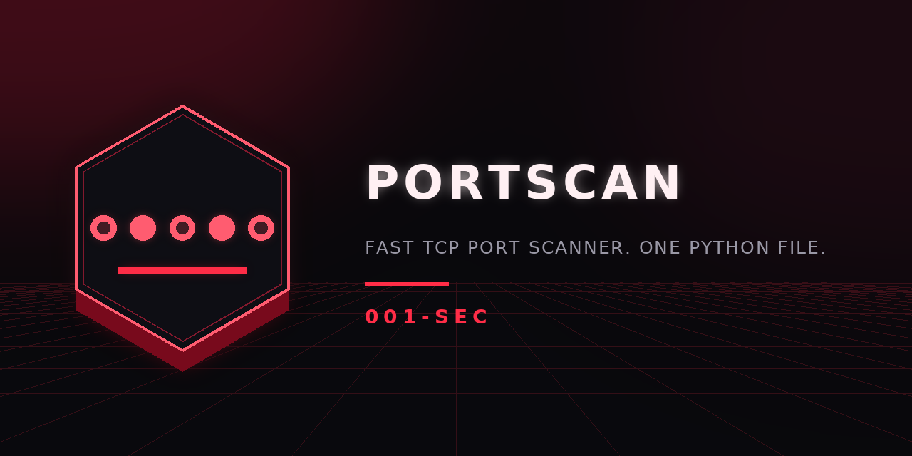

<p align="center">
  
</p>

# portscan

**Fast concurrent TCP port scanner with banner grabbing.** Single file, Python 3 standard library only, zero dependencies.

<p>
  <a href="https://001-sec.github.io/portscan/"></a>
  
  
  
</p>

> **Authorized use only.** Only scan hosts you own or have explicit written permission to test. It is a verification instrument for defenders and learners, in the same category as open-source scanners and audit utilities.

## Quickstart

```bash
curl -O https://raw.githubusercontent.com/001-sec/portscan/main/portscan.py
python3 portscan.py --help
```

Landing page: https://001-sec.github.io/portscan/

A fast, concurrent TCP port scanner with service identification and banner grabbing. Single-file, standard library only, no dependencies.

## Features
- Scans a curated set of common ports by default, or any range/list you give it (`22,80,443` or `1-65535`)
- Hundreds of ports per second via a thread pool
- Optional banner grabbing, with HTTP probing on web ports
- JSON output for pipelines and reports
- Clean exit codes (0 = open ports found, 1 = none)

## Usage
```
python3 portscan.py example.com
python3 portscan.py 192.168.1.10 -p 1-1024 --banners
python3 portscan.py example.com -p 20-25,80,443 -t 500 -o results.json
```

## Options
| Flag | Description |
|---|---|
| `-p, --ports` | Comma list and/or ranges, e.g. `22,80,1000-2000` |
| `-t, --threads` | Worker threads (default 200) |
| `--timeout` | Per-connect timeout in seconds (default 1.0) |
| `--banners` | Grab service banners on open ports |
| `-o, --output` | Write JSON results to a file |


## License
MIT, see [LICENSE](LICENSE).

## Contributing

Issues and pull requests are welcome. Keep it dependency-free and single-file.

---

<p align="center">Built by <a href="https://github.com/001-sec">001-sec</a></p>
